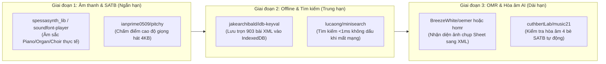

# KẾ HOẠCH BỔ SUNG SKILLS, THƯ VIỆN GITHUB & ĐỒNG NHẤT HỆ THỐNG SHEETAPP 2.0

**Ngày lập & thực thi:** 17/10/2026  
**Nhánh chính:** `main` (`https://github.com/haiyenpa25/sheetapp2`)  
**Trạng thái:** Đã dọn rác, gộp các module trùng lặp, tích hợp 4 Domain Skills mới và vượt 100% Quality Gate (`165 suites — ALL PASS`).

---

## PHẦN 1 — KẾT QUẢ XÓA FILE RÁC, GỘP FILE CÙNG TÍNH NĂNG & ĐỒNG NHẤT HỆ THỐNG

### 1.1. Các thư mục & file rác đã loại bỏ triệt để (~88 files, giải phóng > 4.8 MB)

| Nhóm | Đường dẫn đã xóa | Lý do loại bỏ |
|---|---|---|
| **Rác công cụ ngoài (`understand-anything`)** | `dashboard/` (18 files, ~3.6 MB) `.ua/` (3 files, ~1.04 MB) `.agents/skills/understand*` (63 broken Linux symlinks) `tools/generate_knowledge_graph.mjs` | Sản phẩm thừa từ plugin `understand-anything` trên máy chủ Linux cũ (chứa 63 symlink hỏng trỏ tới `/root/.understand-anything/repo/...`), không thuộc kiến trúc SheetApp2. |
| **Bản mẫu & thư mục rỗng** | `docs-templates/` (4 files) `.claude/` (thư mục rỗng) | Trùng lặp với bộ tài liệu chuẩn ở thư mục gốc (`AI_AGENT.md`, `CODING_STANDARDS.md`, `PROJECT_REGISTRY.md`, `README.md`). |
| **File tạm & batch rời rạc** | `tools/batch_progress.json` `tools/urls.txt` `tools/run_batch.bat` `tools/run_workers.bat` `tools/setup.bat` `create_hd.bat`, `create_hd.sh` | Log chạy cào dữ liệu cũ và các file `.bat`/`.sh` bọc lệnh đơn lẻ gây phân mảnh thư mục gốc và `tools/`. |

---

### 1.2. Các file trùng tính năng đã gộp về Một Nguồn Sự Thật Duy Nhất (Single Source of Truth)

| Tính năng trùng lặp | File đã xóa (Trùng / Cũ) | File giữ lại & Nâng cấp (SSOT) | Hiệu quả sau khi hợp nhất |
|---|---|---|---|
| **1. Sinh Bản đồ Tri thức (`CODE_MAP.md`)** | `tools/generate_code_map.php` | [`tools/generate_code_map.js`](file:///c:/xampp/htdocs/sheetapp2/tools/generate_code_map.js) | Thống nhất 1 công cụ Node.js duy nhất được gọi tự động bởi `sync.bat`, `sync.sh` và `package.json`. |
| **2. Dọn dẹp dữ liệu rác từ E2E / Test** | `tools/cleanup_test_artifacts.php` | [`tools/clean_test_setlists.php`](file:///c:/xampp/htdocs/sheetapp2/tools/clean_test_setlists.php) | Hợp nhất toàn bộ logic dọn `setlists`, `domain_events`, `notifications` và khôi phục email Admin vào 1 CLI tool chuẩn hỗ trợ `--dry-run`, `--backup`, `--execute`. |
| **3. Kiểm tra toàn vẹn Sao lưu SQLite** | `tools/verify_backup.php` | [`tools/restore_encrypted_backup.php`](file:///c:/xampp/htdocs/sheetapp2/tools/restore_encrypted_backup.php) | Đã tích hợp sẵn kiểm tra `PRAGMA integrity_check` trong quy trình khôi phục mã hóa AES-256-GCM. |
| **4. Tầng Core JS (`EventBus`, `Store`, `ApiService`, `ServiceWorkerManager`)** | `old/assets/js/core/EventBus.js` `old/assets/js/core/Store.js` `old/assets/js/core/ApiService.js` `old/assets/js/core/ServiceWorkerManager.js` | [`assets/js/core/EventBus.js`](file:///c:/xampp/htdocs/sheetapp2/assets/js/core/EventBus.js) [`assets/js/core/Store.js`](file:///c:/xampp/htdocs/sheetapp2/assets/js/core/Store.js) [`assets/js/core/ApiService.js`](file:///c:/xampp/htdocs/sheetapp2/assets/js/core/ApiService.js) [`assets/js/core/ServiceWorkerManager.js`](file:///c:/xampp/htdocs/sheetapp2/assets/js/core/ServiceWorkerManager.js) | Giao diện Chính (`/`) và Giao diện Cũ (`/old/`) dùng chung **100% tầng Core**. `/old/` được hưởng ngay cơ chế chống gọi trùng API (in-flight deduplication), cache bộ hợp âm, offline fallback `songs_cache.json` và CSRF Token. |
| **5. Tầng Engine & State dùng chung** | `old/assets/js/url-state.js` `old/assets/js/history-manager.js` `old/assets/js/session-tracker.js` `old/assets/js/transpose-engine.js` `old/assets/js/audio-player.js` `old/assets/js/annotation-canvas.js` | [`assets/js/url-state.js`](file:///c:/xampp/htdocs/sheetapp2/assets/js/url-state.js) [`assets/js/history-manager.js`](file:///c:/xampp/htdocs/sheetapp2/assets/js/history-manager.js) [`assets/js/session-tracker.js`](file:///c:/xampp/htdocs/sheetapp2/assets/js/session-tracker.js) [`assets/js/transpose-engine.js`](file:///c:/xampp/htdocs/sheetapp2/assets/js/transpose-engine.js) [`assets/js/audio-player.js`](file:///c:/xampp/htdocs/sheetapp2/assets/js/audio-player.js) [`assets/js/annotation-canvas.js`](file:///c:/xampp/htdocs/sheetapp2/assets/js/annotation-canvas.js) | Nâng cấp hàm `jsTag()` trong [`old/index.php`](file:///c:/xampp/htdocs/sheetapp2/old/index.php#L178-L190) tự động nạp từ `../assets/js/` khi file không có bản ghi đè giao diện riêng trong `old/assets/js/`. Loại bỏ ~1.900 dòng JS trùng lặp và tự động sửa lỗi thiếu `HistoryManager.getRecent()` trên `/old/`. |

---

## PHẦN 2 — BỘ AGENT SKILLS CHUYÊN BIỆT CHO SHEETAPP 2.0 (ĐÃ TÍCH HỢP VÀO `.agent-skills/`)

Trước đây `.agent-skills/` chỉ có 20 kỹ năng kỹ thuật phần mềm tổng quát, thiếu hẳn các kỹ năng chuyên sâu về **MusicXML/OSMD, WebAudio SATB, SQLite FTS5/SSE và Dual-UI PWA**. Chúng tôi đã xây dựng và đăng ký 4 Domain Skills mới vào [`.agent-skills/using-agent-skills/SKILL.md`](file:///c:/xampp/htdocs/sheetapp2/.agent-skills/using-agent-skills/SKILL.md) và [`GEMINI.md`](file:///c:/xampp/htdocs/sheetapp2/GEMINI.md):

1. **[`musicxml-osmd-engineering`](file:///c:/xampp/htdocs/sheetapp2/.agent-skills/musicxml-osmd-engineering/SKILL.md)**
   - Bảo vệ 4 Core Rules bất biến (`HD` mặc định, `currentTranspose = 0`, Khóa `TLH`/`HD`, Đồng bộ Setlist).
   - Chuẩn hóa ánh xạ tọa độ SVG OSMD (`MeasureList`, `_loadToken` chống race-condition) và cache `DOMParser` trong `TransposeEngine`.
2. **[`webaudio-midi-satb`](file:///c:/xampp/htdocs/sheetapp2/.agent-skills/webaudio-midi-satb/SKILL.md)**
   - Quản lý vòng đời `AudioContext` (chống vượt giới hạn 6 hardware contexts và tự động `resume()` trên iOS Safari).
   - Chuẩn hóa Lookahead Scheduler (`25ms` timer / `100ms` scheduleAhead) cho Metronome và thuật toán tách 4 bè hợp xướng SATB (Soprano, Alto, Tenor, Bass).
3. **[`sqlite-fts5-sync-architecture`](file:///c:/xampp/htdocs/sheetapp2/.agent-skills/sqlite-fts5-sync-architecture/SKILL.md)**
   - Quy chuẩn SQLite WAL (`busy_timeout = 5000`), 100% Prepared Statements, cách ly DB khi chạy test (`SHEETAPP_DB_PATH`).
   - Kiến trúc SSE (`session_write_close()` trước vòng lặp) cho phòng tập Live Band (`LiveSyncService`).
4. **[`pwa-offline-stage-performance`](file:///c:/xampp/htdocs/sheetapp2/.agent-skills/pwa-offline-stage-performance/SKILL.md)**
   - Quy chuẩn đồng nhất giữa Giao diện Chính (`/`) và Giao diện Cũ (`/old/`), Virtual Scrolling `ROW_HEIGHT = 26`, đường dẫn tương đối PWA và giới hạn `< 600` dòng/file.

---

## PHẦN 3 — KẾ HOẠCH TÍCH HỢP CÁC THƯ VIỆN MÃ NGUỒN MỞ GITHUB TỐT NHẤT CHO HỆ THỐNG

Dưới đây là lộ trình chọn lọc các repository mã nguồn mở tốt nhất trên GitHub, tương thích hoàn toàn với kiến trúc **Vanilla JS + PHP 8 + SQLite (Zero-Framework Overhead)** của SheetApp2:

### 3.1. Nhóm 1 — Nâng cấp Âm thanh Hợp xướng SATB & Bắt cao độ Giọng hát (Ưu tiên Cao)

| Thư viện GitHub | Dung lượng / Giấy phép | Mục đích & Giá trị cho SheetApp2 | Vị trí tích hợp dự kiến |
|---|---|---|---|
| **[`danigb/soundfont-player`](https://github.com/danigb/soundfont-player)** hoặc **[`spessasus/spessasynth_lib`](https://github.com/spessasus/spessasynth_lib)** | ~15 KB (MIT) | Thay thế tiếng synth điện tử đơn điệu bằng âm sắc **Acoustic Grand Piano, Church Organ (Đàn ống nhà thờ) và Choir Aahs** chuẩn SoundFont, chạy offline trên trình duyệt. | `assets/js/audio-player.js`, `assets/js/learn/transport/learn-transport-bridge.js` |
| **[`ianprime0509/pitchy`](https://github.com/ianprime0509/pitchy)** | ~4 KB (MIT) | Thuật toán **McLeod Pitch Method (MPM)** thuần JS siêu nhẹ và chính xác hơn tự viết autocorrelation, giúp ca viên hát vào micro iPad/điện thoại và chấm điểm đúng nốt bè S/A/T/B theo thời gian thực. | `assets/js/learn/` (Module luyện hát theo bè) |
| **[`tonaljs/tonal`](https://github.com/tonaljs/tonal)** (Mở rộng gói `@tonaljs/progression` & `@tonaljs/key`) | Đã có sẵn core (MIT) | Khai thác sâu các hàm phân tích bậc hòa âm (`Roman Numerals: I - IV - V7 - I`) để hiển thị bậc hợp âm tự động khi ca trưởng đổi tông trên sân khấu. | `assets/js/transpose-engine.js`, `live-band/js/stage-hud.js` |

### 3.2. Nhóm 2 — Lưu trữ Offline Toàn diện 903 Bài Thánh Ca & Tìm kiếm Tức thì trên iPad

| Thư viện GitHub | Dung lượng / Giấy phép | Mục đích & Giá trị cho SheetApp2 | Vị trí tích hợp dự kiến |
|---|---|---|---|
| **[`jakearchibald/idb-keyval`](https://github.com/jakearchibald/idb-keyval)** | **~600 bytes** (Apache-2.0) | `localStorage` bị giới hạn 5MB nên không thể lưu toàn bộ 903 file MusicXML. `idb-keyval` giúp lưu trọn bộ **903 bản nhạc MusicXML + Bộ hợp âm HD (~35MB)** vào `IndexedDB` chỉ với 1 nút *"Tải toàn bộ Thánh Ca về máy dùng không cần mạng"*. | `assets/js/core/ApiService.js`, `sw.js` |
| **[`lucaong/minisearch`](https://github.com/lucaong/minisearch)** | ~7 KB (MIT) | Công cụ Full-Text Search nhỏ gọn trên bộ nhớ client, hỗ trợ **bỏ dấu tiếng Việt + tìm kiếm mờ (fuzzy typo-tolerance)** trong `< 1ms` ngay cả khi iPad ngắt kết nối Wi-Fi hoàn toàn trên bục giảng/sân khấu. | `assets/js/library-ui.js`, `old/assets/js/library-ui.js` |

### 3.3. Nhóm 3 — Nhận diện Bản nhạc Quang học (OMR) & Kiểm tra Hòa âm 4 Bè Tự động (Backend / CLI Tools)

| Thư viện GitHub | Ngôn ngữ / Giấy phép | Mục đích & Giá trị cho SheetApp2 | Vị trí tích hợp dự kiến |
|---|---|---|---|
| **[`LukaszTracewski/homr`](https://github.com/LukaszTracewski/homr)** hoặc **[`BreezeWhite/oemer`](https://github.com/BreezeWhite/oemer)** | Python / ONNX (MIT) | Chuyển đổi ảnh chụp / PDF bản nhạc Thánh Ca sang file `.musicxml` bằng mô hình học sâu chạy trên CPU (nhẹ và dễ cài hơn Audiveris Java truyền thống). | `tools/omr_sync.php`, `api/omr_worker.php` |
| **[`cuthbertLab/music21`](https://github.com/cuthbertLab/music21)** | Python (BSD-3) | Bộ công cụ chuẩn học thuật của MIT để quét toàn bộ 903 file MusicXML trong `ThanhCa-MusicXML/`, tự động phát hiện lỗi **quãng 5 / quãng 8 song song** trong hòa âm 4 bè SATB và chuẩn hóa tự động giọng (`keySignature`), nhịp (`timeSignature`). | `tools/extract_keys.php`, `editor/js/editor-ai.js` |

### 3.4. Lộ trình Triển khai Đề xuất (3 Sprint)

1. **Sprint S1 (1–2 ngày — Offline IndexedDB & Search):**
   - Nhúng `idb-keyval` (~600B) vào `assets/js/vendor/idb-keyval.min.js`.
   - Thêm nút *"📦 Tải trọn bộ 903 bài Offline"* trên cả giao diện `/` và `/old/` để lưu toàn bộ `songs_cache.json` + XML vào IndexedDB.
2. **Sprint S2 (2–3 ngày — Âm sắc Church Organ / Choir & Bậc Hòa âm La Mã):**
   - Bổ sung chế độ hiển thị **Bậc hợp âm (Nashville / Roman: `I`, `IV`, `V7`, `vi`)** song song với tên hợp âm (`C`, `F`, `G7`, `Am`) cho ban nhạc.
   - Tích hợp SoundFont nhẹ cho tiếng **Đàn ống Nhà thờ (Church Organ)** và **Piano** khi phát mẫu SATB.
3. **Sprint S3 (2–3 ngày — Luyện hát bắt cao độ `pitchy` & Kiểm toán MusicXML bằng `music21`):**
   - Tích hợp `pitchy` vào trang `/learn/` để hiển thị đường cao độ giọng hát thực tế so với nốt nhạc của bè đang tập.
