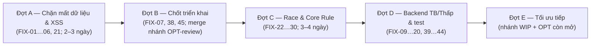

# PHƯƠNG ÁN 2 — Sửa lỗi & tối ưu SheetApp2 (2026-10-21)

> **Người đọc:** chủ dự án (duyệt, trả lời mục 7) và **một** người/AI thực thi.
> **Mốc rà soát:** nhánh `fix/opt-review-20261021` (HEAD `b7f5f13` cộng các thay đổi chưa commit của phiên OPT-review) và 6 nhánh agent `worktree-agent-*`.
> **Luật thực thi:** `ROADMAPS.md` mục 2. Mỗi lỗi sửa bằng TDD, có output FAIL → PASS; test không ghi DB/storage thật; không push/deploy.
> **Nhật ký thực thi:** [kết quả từng FIX và phần còn mở](docs/PHUONG_AN_2_EXECUTION.md): bộ tổng 207/207 suite đạt; Q-C/Q-D đã backup và apply. FIX-38/45 còn việc chủ dự án, tối ưu Đợt E còn mở. Không sửa bảng quyết định mục 7.
> **Quan hệ với tài liệu khác:**
> - File này **nối tiếp** `PHUONG_AN_TOI_UU_HE_THONG.md` (OPT-01…26), không thay thế. Trạng thái từng OPT xem `docs/OPT_REVIEW_2026-10-21.md`.
> - Ticket trang Thư viện vẫn thuộc `ROADMAP6.md`.
> - Ticket mới ở đây dùng tiền tố **FIX-** (lỗi) và **P2-** (tối ưu).
> **Phương pháp:**
> - Đọc mã: 3 lượt rà song song (backend, frontend, test/CI/vận hành).
> - Truy vấn DB thật ở chế độ `mode=ro`.
> - Mục đánh ✅ là đã tự đối chiếu lại trong code hoặc DB. Mục không đánh dấu là phát hiện từ đọc mã, cần tái hiện bằng test trước khi sửa.

---

## 0. TÓM TẮT

**Tình trạng chung:**
- Dữ liệu thật lành mạnh: integrity ok, 0 vi phạm khoá ngoại, mọi bài có XML và bộ HD.
- Phần P0 của phương án 1 cơ bản đã xong: test không còn ghi vào storage, đã dọn 63 backup, client log đi qua router.
- Vẫn còn **7 lỗi mức Cao trong mã** (6 lỗi dưới đây và XSS lưu trữ FIX-21) cùng **2 rủi ro Cao về vận hành** (FIX-07 cờ tính năng, FIX-45 mật khẩu yếu). 2 lỗi trong đó do chính đợt sửa quyền bộ hợp âm (OPT-09) tạo ra. Phải sửa trước khi merge nhánh `fix/opt-review-20261021`.

**6 lỗi Cao nặng nhất trong mã:**

| # | Lỗi | Hậu quả |
|---|---|---|
| FIX-01 ✅ | Gửi duyệt (`reviews&action=submit`) có thể **xoá trắng bộ hợp âm riêng của người khác** | Mất dữ liệu; mọi tài khoản đã đăng nhập đều làm được |
| FIX-02 | Tài khoản bất kỳ tạo được bộ tên `HD` qua `manager&action=fork_song`; bộ giả thành HD chung của bài và không xoá được qua UI | Phá Core Rule 1/3; cả ban nhạc thấy hợp âm sai |
| FIX-03 ✅ | Sửa hợp âm bài A rồi sang bài B: checksum và "bản xác nhận cuối" còn của bài A (`setBaseChecksum` không có ai gọi) | Báo xung đột 409 giả; khi lưu lỗi thì **nạp hợp âm bài A vào bài B** |
| FIX-04 | Lưu hẹn giờ 1,5 s đọc songId/set lúc thực thi, không phải lúc hẹn | Đổi bài trong 1,5 s thì mất chỉnh sửa bài cũ, có thể ghi sang bài mới |
| FIX-05 ✅ | "Theo Ca trưởng": `loadSongXmlDirect` dựng đường dẫn `storage/Thanh ca/<id>.xml` không tồn tại | Máy theo dõi báo lỗi và rơi về màn hình chào mỗi khi Ca trưởng đổi bài |
| FIX-06 ✅ | Classic: tên bộ hợp âm chèn vào HTML không escape (`old/assets/js/song-info-bar.js:122`) | XSS qua `?set=` hoặc `chord_profile` của setlist dùng chung |

**Rủi ro triển khai cần chốt trước khi merge:**
- Commit OPT-06 **ngừng theo dõi `storage/config/features.json`**. Server nào cập nhật bằng `git pull` sẽ bị **xoá** file này, mọi cờ quay về false: Review, Practice, Export, Notifications biến mất. Xem FIX-07.

---

## 1. HIỆN TRẠNG ĐO ĐƯỢC (2026-10-21, chỉ đọc)

| Hạng mục | Kết quả |
|---|---|
| DB thật | `integrity_check = ok`; 0 vi phạm khoá ngoại; 1.731 bài (khớp `songs_fts` 1.731); 0 bài thiếu file XML; 0 bài thiếu bộ HD; 0 tempo giả 104 (1.631 bài chưa có tempo); 16 migration |
| Tài khoản | 5 tài khoản: admin 1, banhat 2, bannhac 1, viewer 1. **2 tài khoản vẫn nhận mật khẩu yếu (chi tiết đã che, xem FIX-45)** |
| Rác test trong DB thật | 0 setlist nhưng còn **81 domain_events** và **37 notifications** từ 26–30/09, trong đó có event `subject_type = test_fixture` và thông báo trỏ tới `?setlist=175` không tồn tại |
| FTS | `songs.rowid ≠ songs_fts.rowid` ở **0/1.731** dòng. Tool nào đồng bộ FTS theo rowid sẽ ghi vào sai bài (FIX-09) |
| Storage | backups 44 MB (10 file, sau Q1); logs 2,4 MB; data 11 MB |
| Kiểm thử (theo `docs/OPT_REVIEW_2026-10-21.md`) | 184/184 suite, 3.740 checks PASS (`--strict --js`, Apache riêng); smoke Chromium/WebKit 8/8 |
| Phương án 1 | Xong hoặc gần xong: OPT-01…07, 09, 11, 13. Một phần: 08, 17, 18, 26. Chưa làm: 10, 12, 14–16, 19–25 |

---

## 2. DANH SÁCH LỖI

Mức độ: **Cao** = mất dữ liệu, bảo mật, phá Core Rule. **TB** = sai chức năng có thể gặp. **Thấp** = biên hoặc tiềm ẩn.

### 2.1 Backend

| ID | Mức | Vị trí | Kịch bản | Cách sửa |
|---|---|---|---|---|
| FIX-01 ✅ | Cao | `api/services/ReviewService.php:46-47`; `ChordSetService::saveSet` (~164) tìm dòng chỉ theo `song_id + set_name` | Người dùng gửi duyệt với `set_name` trùng bộ **riêng tư** của người khác (ví dụ `NAM`). `loadSet` nay lọc quyền nên trả `[]`, rồi `saveSet` gặp dòng của nạn nhân và ghi `chords_json='[]'`, ghi đè cả file đĩa | Không gọi `saveSet` trong luồng gửi duyệt; không tìm thấy bộ của chính mình thì trả 404. `saveSet` chỉ cập nhật dòng `user_id` của người gọi, hoặc dòng chuẩn khi có quyền |
| FIX-02 | Cao | `ManagerService.php:221-246` (`fork_song`), `:319` (đổi tên); `ChordSetService.php:284` (fork) | Tạo bộ `HD`/`hd`/`TLH`. `loadSet`/`listSets` sắp xếp `ORDER BY (set_name=?) DESC, updated_at DESC` nên bộ giả mới nhất thành HD chung; chốt xoá alias lại chặn xoá nó | Một hàm `ChordSetNames::isReserved()` không phân biệt hoa thường, áp dụng **sau khi sanitize**, cho fork/clone/save/rename/saveUserChordSet. Truy vấn HD chỉ nhận dòng chính thức |
| FIX-09 ✅ | TB | `tools/manage_song_labels.php:158-160`, `tools/check_song_spelling.php:92` | Đồng bộ FTS bằng `songs.rowid = songs_fts.rowid`, nhưng DB thật khớp 0/1.731. Chạy `--seed` hoặc `--fix` là ghi nhãn/tiêu đề vào sai bài trong chỉ mục tìm kiếm | Dùng `SongSearchHelper::syncSongFts($id)` hoặc update theo `song_id`. Thêm test fixture có rowid lệch |
| FIX-10 | TB | `api/core/RotatingLog.php:17-18` | Đổi tên file lỗi một lần (Windows/antivirus đang giữ file): log vượt 5 MiB, mọi `append` trả false mãi, audit ngừng ghi mà không báo. Lock do user khác tạo cũng gây mất log | Đổi tên lỗi thì vẫn ghi tiếp vào file cũ và `error_log`; không mở được lock thì ghi với `LOCK_EX` |
| FIX-11 | TB | `ManagerRepertoireHelper.php:186-283`, `ManagerController.php:51-80` | `search_songs`, `song_details`, `versions` không cần đăng nhập và không áp `visibilitySqlClause`. Khách đọc được tiêu đề, xmlPath và lời của bài private. Chưa lộ vì hiện cả 1.731 bài đều public | Áp `SongService::visibilitySqlClause` và `canViewSong` |
| FIX-12 | TB | `SetlistOfflineHelper.php:72`, `ChordProService.php:66` | Mục chương trình dùng bộ riêng của ca trưởng. Từ khi `loadSet` lọc theo người gọi, thành viên nhận `[]` mà không có cảnh báo, mất hợp âm khi tập hoặc offline | Theo **Q-B**: cảnh báo khi thêm bộ không công khai vào chương trình; gói offline đánh dấu `forbidden` thay vì trả rỗng |
| FIX-13 | TB | `ChordSetService.php:181, 363` | Dòng cũ tạo với `user_id=1` nhưng username `banhat` (DB thật: id 5, 6, 8). Chủ thật xoá thì `rowCount=0`, nhận 403 "được bảo vệ" (thông báo sai) | Migration gán lại chủ theo username, **cần backup và Q-C**. Sửa thông báo lỗi |
| FIX-14 | Thấp | `SongVersionHelper.php:183-199` | Slug `v{count+1}`: xoá v2 rồi tạo bản mới thì ghi đè file của v3, hai dòng DB trỏ cùng một file | Dùng `MAX(id)+1` hoặc hậu tố ngẫu nhiên, kiểm tra `file_exists` |
| FIX-15 | Thấp | `SongService.php:183-190, 58` | `writePublicCache` đọc DB **ngoài** khoá nên có thể ghi cache cũ với mtime mới; `invalidateCache` bỏ qua khi không mở được `.lock` | Đọc trong khoá hoặc dùng số thế hệ; không có lock thì vẫn unlink |
| FIX-16 | Thấp | `api/index.php` case `export` | Cờ `EXPORT_CHORDPRO` chỉ kiểm khi `format=chordpro`; `format=text` vượt qua được | Kiểm cờ trong `ExportController` cho mọi định dạng |
| FIX-17 | Thấp | `LiveSyncService.php:116` | Phòng quá 2 giờ bị coi là "stale" dù `expiresAt` 12 giờ; người khác tạo lại cùng mã phòng là chiếm quyền host | Chỉ xét `expiresAt` và `active` |
| FIX-18 | Thấp | `AuthController` logout | Đăng xuất bằng GET; link từ trang khác có thể đăng xuất người dùng | Chỉ nhận POST, cập nhật `ApiService.auth.logout` |
| FIX-19 | Thấp | Đăng ký: `chord_code` = 4 ký tự đầu username, không unique | Hai người cùng mã ghi đè bộ của nhau khi đã có quyền banhat | Ràng buộc unique, sinh mã không trùng (**cần migration, Q-C**) |
| FIX-20 | Thấp | `client_log` rate-limit 10 lần/15 phút/IP | Mạng nhà thờ dùng chung IP: vài máy là log bị chặn hết | Hạn mức theo IP + session; nới ngưỡng |

### 2.2 Frontend

| ID | Mức | UI | Vị trí | Kịch bản | Cách sửa |
|---|---|---|---|---|---|
| FIX-03 ✅ | Cao | Modern | `assets/js/chord-canvas-edit.js:241, 285-372, 406` | `setBaseChecksum` không ai gọi; checksum và "bản xác nhận cuối" giữ giá trị của bài trước | Gọi `setBaseChecksum(r.checksum, chords)` trong `ChordCanvas.loadSong`, `switchSet`, `applyPreloaded` |
| FIX-04 | Cao | Modern | `chord-canvas-edit.js:268-308` | `executeSave` đọc songId/set/chords lúc chạy (sau 1,5 s), không phải lúc hẹn | Chụp songId/set/chords khi hẹn; `flushSave()` trước `SongLoader.load` và `switchSet` |
| FIX-05 ✅ | Cao | Modern | `assets/js/app.js:209-210`, `performance/performance-engine.js:118-119` | Đường dẫn XML dựng cứng nên 404 | Dùng XML đã có hoặc tra song object (LibraryUI/ApiService) |
| FIX-06 ✅ | Cao | Classic | `old/assets/js/song-info-bar.js:122` | `${currentSet}` không escape | `_esc(currentSet)` |
| FIX-21 | Cao | Classic, live-band | `live-band/js/stage-catalog.js:17`; `old/assets/js/admin-ui.js:84-85, 169, 175, 241`; `old/assets/js/importer.js:295` | Tên bài nhập vào, tên danh mục, username đưa thẳng vào innerHTML: XSS lưu trữ nhắm tới host/admin | `SafeHtml.escape` ở mọi chỗ |
| FIX-22 | TB | Modern | `chord-canvas.js:147-171, 560-564` | `applyPreloaded` không tăng `_chordLoadToken`: hợp âm bài A về muộn trộn vào bài B | `++_chordLoadToken` |
| FIX-23 | TB | Cả hai | `chord-canvas.js:348-366`; `old/.../chord-canvas.js:366-380` | `switchSet` không kiểm tra token/songId sau `await` | Chụp token và songId, so lại sau `await` |
| FIX-24 | TB | Classic | `old/assets/js/song-loader.js:13-77` | Không có load token: đổi bài nhanh thì bài cũ vẽ đè bài mới | Port cơ chế `_currentLoadToken` của Modern |
| FIX-25 | TB | Modern | `assets/js/setlist-player.js:118-213` | Không có `_playToken`: bấm ▶ hai lần thì BPM mục trước ghi đè (Core Rule 4) | Thêm play token như Classic |
| FIX-26 | TB | Cả hai | `assets/js/performance-notes.js:35-56` (+ bản old) | Nhật ký bài A hiện và tự lưu dưới bài B | Kiểm `songId === _songId` sau `await` |
| FIX-27 | TB | Classic | `old/assets/js/song-info-bar.js:107-113` | Thiếu "Tông: X \| Tập: Y" và tempo của setlist (Core Rule 4) | Port `_render` của Modern |
| FIX-28 ✅ | TB | Classic | `old/assets/js/song-loader.js:48, 52` | Gọi `OfflineVault.saveSongXml/getSongXml`, không tồn tại (chỉ có `saveXml/getXml`): Classic offline không chạy | Đổi sang `saveXml(song.xmlPath, …)` / `getXml(song.xmlPath)` |
| FIX-29 | TB | Modern | `.htaccess` chặn `storage/users/`; `SongVersionHelper.php:196`; `song-loader.js:553-562` | Chọn phiên bản MusicXML thì 403, báo lỗi XML | Route API phục vụ XML phiên bản có kiểm quyền |
| FIX-30 | TB | Modern | `core/OfflineSetlistManager.js:336-350`, `chord-canvas.js:165, 178` | Thiếu profile thì trả HD hoặc **bộ bất kỳ** dưới nhãn HD (Core Rule 1: HD rỗng phải hiện TLH) | Chỉ trả đúng profile; không có thì để trống để fallback TLH |
| FIX-31 | Thấp | Cả hai | `core/ApiService.js:150-160` | Cache danh sách bộ hợp âm không xoá khi đăng nhập/đăng xuất, lộ tên bộ của người trước | Xoá cache khi `auth` đổi |
| FIX-32 | Thấp | Modern | `song-loader.js:15, 86`; `chord-canvas.js:154, 525` | `chord_profile = null` không kích hoạt mặc định `'HD'`, gây TypeError `.toUpperCase()` | `profile \|\| 'HD'` |
| FIX-33 | Thấp | Modern | `chord-canvas.js:31-46, 218-224, 457, 526` | Truy vấn 5 id không tồn tại (`btn-delete-chord-set`…); kết quả xoá bị bỏ qua (`:439-443`) | Xoá mã chết hoặc nối nút; kiểm `r.success` |
| FIX-34 | Thấp | learn | `practice/practice-tracker.js:82, 239, 282-296` | fetch/sendBeacon không có `X-CSRF-Token`, sẽ 403 khi bật `csrf_enforce` | Thêm header; beacon gửi token trong body. **Làm trước OPT-10** |
| FIX-35 | Thấp | Cả hai | `chord-canvas-dots.js:416, 579`; `osmd-renderer.js:108` | Popup mở khi chạm xuống (vuốt cuộn cũng mở); thiếu `touchcancel` nên SVG kẹt phóng to | Mở khi `pointerup` có ngưỡng di chuyển; thêm `touchcancel` |
| FIX-36 | Thấp | Modern | `setlist-detail.js:188, 228` | Escape hai lần, hiện `&amp;` | Bỏ một lần `_esc` |
| FIX-37 | Thấp | Modern | `sw.js:180-199, 282-341` | Offline: mọi trang đều nhận app shell Modern; danh sách bài trong cache dùng chung giữa người dùng trên một máy | Fallback theo đường dẫn; cache danh sách theo vai trò, hoặc chỉ cache bản public |

### 2.3 Test, CI, vận hành

| ID | Mức | Vị trí | Vấn đề | Cách sửa |
|---|---|---|---|---|
| FIX-07 | Cao (triển khai) | `.gitignore:64` + `git rm --cached storage/config/features.json` | `git pull` trên server xoá file, mọi cờ về false | Theo **Q-A**: giữ file override ngoài Git (`features.local.json`) và nạp sau `features.json` mặc định có trong Git, **hoặc** ghi bước sao lưu/khôi phục vào runbook trước khi merge |
| FIX-38 | TB | `assets/.htaccess:22-28` | Gzip dựng sẵn dùng `Header set Content-Encoding`, không chạy trên OpenLiteSpeed (production). Chưa kiểm production | `curl -I` trên production. Nếu thiếu `Content-Encoding` thì tắt rewrite `.gz` ở đó ngay |
| FIX-39 | TB | `tests/library_l56_…:56` | Chạy generator thật nên ghi đè `sw.js` (file tracked) mỗi lượt test | Thêm `--check` cho generator (đã có ở nhánh `aeaa6`, xem mục 4) |
| FIX-40 | TB | `tests/hd_history_and_permission_regression.php:50`, `review_integrity_f4_regression.php:60`, `review_workflow_regression.php:230` | Chạy riêng (không qua runner) thì ghi vào `storage/data/chord_sets` thật | Mỗi suite tự đặt thư mục tạm, không dựa vào biến môi trường của runner |
| FIX-41 | TB | `e2e/global-teardown.js:11, 41-45`; 47 spec gọi `C:\xampp\php\php.exe tools/create_test_session.php` | Teardown chép snapshot đè `app.sqlite` thật khi Apache có thể đang giữ WAL; `rmSync` nuốt lỗi; spec ghi session vào DB thật; đường dẫn Windows cứng | E2E chỉ chạy trên bản sao cách ly (như `roadmap6.config.js`); cấm global setup/teardown trên DB thật; dùng `PHP_BINARY`/biến môi trường |
| FIX-42 | Thấp | `tests/http/live_sync_*.php:103, 134`; `backup_restore_drill_regression.php:40`; `run_all_tests.php:170` | Đường dẫn php/node cứng; sleep gây chập chờn | `PHP_BINARY`, `process.execPath`; chờ theo điều kiện |
| FIX-43 | TB | `docs/STAGING_AND_BACKUP_RUNBOOK.md:17, 41, 59, 108` | Nhắc tool không tồn tại (`check_db.php`, `verify_sqlite_backup.php`); truyền passphrase qua argv; ghi "tự động backup" nhưng không có scheduler; backup `.tar.gz.enc` không khớp mẫu prune | Viết lại runbook theo tool thật; passphrase qua biến môi trường/stdin; lịch backup (Task Scheduler hoặc cron) và chính sách giữ cho file mã hoá |
| FIX-44 | TB | DB thật | 81 domain_events + 37 notifications rác test (26–30/09) | Theo **Q-D**: tool dọn dry-run → duyệt → `--apply`, backup trước |
| FIX-45 | Cao (bảo mật vận hành) | DB thật | 2 tài khoản nhận mật khẩu yếu (đã che); chi tiết cũ còn trong lịch sử Git đã public (`595b507`, `6819f39`) | Theo **Q-E**: đổi mật khẩu hoặc hạ quyền. Không cần viết lại lịch sử Git nếu mật khẩu đã đổi |
| FIX-08 | Thấp | `.gitattributes:2` | `merge=ours` cho file không còn được track | Bỏ dòng |

---

## 3. LỘ TRÌNH

### Đợt A — Chặn mất dữ liệu và XSS (làm ngay, trên nhánh `fix/opt-review-20261021` trước khi merge)
1. FIX-01 và FIX-02 (cùng khu vực `ChordSetService`/`ManagerService`/`ReviewService`). Test hành vi:
   - người lạ gửi duyệt trùng tên bộ riêng, dữ liệu nạn nhân không đổi;
   - tạo `HD`/`hd`/`HĐ`/`tlh` bị từ chối;
   - HD chính thức vẫn được đọc.
2. FIX-03 và FIX-04 (lưu hợp âm). E2E: sửa bài A, đổi bài trong 1 s, sửa bài B; DB có đúng hợp âm của cả hai bài, không có 409.
3. FIX-05 (theo Ca trưởng). E2E hai trình duyệt: host đổi bài, follower vẽ đúng bài.
4. FIX-06 và FIX-21 (XSS). Test payload `` trên Classic, live-band, admin.

### Đợt B — Chốt triển khai (trước khi merge vào `main`)
- FIX-07: chọn phương án Q-A và ghi vào `docs/LIBRARY_DATA_RELEASE.md` hoặc runbook.
- FIX-38: kiểm gzip trên production bằng `curl -I` (chủ dự án hoặc người có quyền server).
- FIX-45: đổi mật khẩu 2 tài khoản (việc của chủ dự án).
- Commit phần chưa commit của phiên OPT-review cùng Đợt A. Cập nhật `docs/OPT_REVIEW_2026-10-21.md` và trạng thái OPT trong `PHUONG_AN_TOI_UU_HE_THONG.md` (các tiêu đề OPT-02/03/06/07/11/13 chưa đánh dấu xong; `ROADMAPS.md` vẫn ghi "chờ duyệt").

### Đợt C — Race condition và Core Rule
FIX-22…30. Ưu tiên FIX-25, FIX-27 và FIX-30 vì phá Core Rule 4 và 1. Mỗi ticket có E2E đổi bài nhanh trên **cả hai giao diện**.

### Đợt D — Backend mức TB/Thấp và độ tin cậy của test
- Sửa tool: FIX-09 trước tiên, vì chạy tool gắn nhãn hiện tại sẽ làm hỏng chỉ mục tìm kiếm.
- Sau đó: FIX-10…20.
- Test: FIX-39…42.
- Vận hành: FIX-43 và FIX-44.

### Đợt E — Tối ưu tiếp (thay cho phần còn mở của phương án 1)

| ID | Việc | Nguồn | Ghi chú |
|---|---|---|---|
| P2-01 | Cherry-pick `11eacc9` (OPT-17: generator manifest từ `index.php`, hash không phụ thuộc xuống dòng, có `--check`) rồi sinh lại `sw.js` | nhánh `aeaa6` | Giải quyết luôn FIX-39 |
| P2-02 | Cherry-pick `e14b7af` (OPT-23: một bộ đọc SATB cho editor và learn; golden SHA 6 bài thật) | nhánh `a5852` | Thay đổi nhỏ có chủ ý: `alter` không phải số coi là 0 |
| P2-03 | Ghép `32eb9f6` và `cf45156` (OPT-22 bước 1: test đặc tả transport + gộp code trùng) | nhánh `a6fa5` | Mục tiêu một transport chung chưa đạt. Phải sửa FIX-05 trước |
| P2-04 | OPT-14 gzip toàn bộ asset (`7b88322`, `f25c31a`) | nhánh `aeaa6` | **Chờ FIX-38**. Nếu OpenLiteSpeed không hỗ trợ thì bỏ, dùng nén của máy chủ |
| P2-05 | OPT-15 bỏ thẻ script trùng preset ScriptLoader (mục tiêu ≤ 40 JS) | ROADMAP6 TV2-2 | Đo lại 4G sau khi làm |
| P2-06 | OPT-18 CI: thêm `--strict --js`, generator `--check`, smoke Playwright Chromium | ý tưởng nhánh `ae4ed` | **Làm lại** trên cây hiện tại, giữ bước tạo config fixture của phiên OPT-review |
| P2-07 | OPT-19 runner: suite không khai báo thì tính là static; đếm từ nhãn PASS:B/PASS:S | ý tưởng nhánh `ae4ed` | Không tin số liệu B/S suite tự khai |
| P2-08 | OPT-20 index `songs(httlvnId)` + gom truy vấn hợp âm gói offline **có lọc quyền** | ý tưởng nhánh `a1484` | Bản ở nhánh bỏ qua lọc quyền nên **không ghép nguyên trạng** |
| P2-09 | OPT-12 SQLite là nguồn duy nhất của bộ hợp âm | `docs/OPT_REVIEW_2026-10-21.md` | Chờ Q6 cho 3 file lệch (57/60). `song-f3-test` là fixture, nên chuyển vào `tests/fixtures` (FIX-40) |
| P2-10 | OPT-24 tách `ManagerService` (`e1e72c5`) | nhánh `a5852` | Chờ Q8; thân hàm giữ nguyên nên cherry-pick được khi duyệt |
| P2-11 | OPT-21 Classic dùng chung module; OPT-25 CSS | ROADMAP6 TV6, TV3-7 | Bắt đầu sau Đợt C, vì FIX-24/27/28 là lỗi ở chính các file fork của Classic |
| P2-12 | Đồng bộ `PROJECT_REGISTRY.md` với code | — | Mục 3/4/5/8 lệch: thiếu 8 controller và ~12 route; schema ghi sai tên cột/bảng (`xml_path`, `chord_sets`…); load order sai; `DB::getConnection()` không tồn tại |
| P2-13 | Viết E2E cho live-band, learn, editor | — | Hiện chỉ có 3/1/2 spec; mọi refactor OPT-22/23 cần lưới an toàn này |

---

## 4. XỬ LÝ 6 NHÁNH AGENT DỞ DANG

5/6 nhánh tách từ `b668991`. Xem diff thật bằng 3 chấm: `git diff b7f5f13...<nhánh>`. Mọi worktree đều có `sw.js` bị sửa do test l56; **bỏ thay đổi đó**.

| Nhánh | Nội dung | Khuyến nghị |
|---|---|---|
| `worktree-agent-a3506707473d61e77` | OPT-09 bản khác | **Bỏ.** Phiên OPT-review đã làm; bản này cho admin đọc mọi bộ, trái Q4 |
| `worktree-agent-a14848d9fa73f19c1` | OPT-11/13 bản khác + OPT-20 chưa commit | **Bỏ các commit**; chỉ lấy ý tưởng OPT-20 (P2-08) và làm lại có lọc quyền |
| `worktree-agent-aeaa6d7dd828f5e0a` | OPT-17, OPT-14, OPT-08 (xoá `key-service.js`) | Cherry-pick `11eacc9` (P2-01). `d49106d` sau khi duyệt mã chết. OPT-14 chờ FIX-38 |
| `worktree-agent-ae4ed445798724354` | OPT-18/19 chưa commit | **Làm lại** theo P2-06/P2-07 |
| `worktree-agent-a5852fa0692ae36ea` | OPT-23 `e14b7af`, OPT-24 `e1e72c5`; chưa commit: rác `song-A/B` trong storage của worktree | Cherry-pick `e14b7af`; giữ `e1e72c5` chờ Q8; bỏ phần chưa commit |
| `worktree-agent-a6fa51707e64ec9a6` | OPT-22 bước 1 | Ghép sau FIX-05 (P2-03) |

Sau khi lấy xong, gỡ các worktree bằng `git worktree remove` (việc dọn này cần chủ dự án xác nhận).

---

## 5. THỨ TỰ THỰC HIỆN

| Đợt | Ticket | Điều kiện |
|---|---|---|
| A | FIX-01, 02, 03, 04, 05, 06, 21 | Không cần quyết định; báo chủ dự án vì FIX-01/02 là lỗ hổng mới |
| B | FIX-07, 08, 38, 45; commit và merge nhánh OPT-review | Q-A, Q-E; kiểm production |
| C | FIX-22…30 | — |
| D | FIX-09…20, 39…44 | Q-B, Q-C, Q-D cho FIX-12/13/19/44 |
| E | P2-01…13 | Q6, Q7, Q8 của phương án 1 cho P2-09/10 và OPT-16 |

---

## 6. THANG NGHIỆM THU

| Chỉ số | Hiện tại | Mục tiêu |
|---|---|---|
| Lỗi mức Cao còn mở | 9 (FIX-01…07, 21, 45) | 0 |
| Người dùng thường xoá hoặc ghi đè được bộ hợp âm của người khác | có | không (test HTTP) |
| Tạo được bộ tên HD/TLH/default (mọi biến thể hoa thường, dấu) | có | không |
| Đổi bài trong lúc chờ lưu: mất chỉnh sửa hoặc lưu sai bài | có | không (E2E) |
| Follower theo Ca trưởng vẽ đúng bài | không | có (E2E hai trình duyệt) |
| XSS lưu trữ / phản xạ đã biết | 4 vị trí | 0 |
| Core Rule 1 và 4 trên Classic | lệch | đạt (E2E Classic) |
| Test chạy riêng lẻ ghi vào storage/tracked file | ≥ 4 suite | 0 |
| E2E đụng DB thật | có (teardown/session) | 0 |
| Cờ tính năng sau `git pull` trên server | bị xoá | giữ nguyên |
| Rác test trong DB thật | 81 event + 37 thông báo | 0 (sau Q-D) |
| Tài khoản nhận mật khẩu yếu | 2 | 0 |

---

## 7. QUYẾT ĐỊNH CẦN CHỦ DỰ ÁN

| # | Câu hỏi | Đề xuất |
|---|---|---|
| Q-A | Cấu hình cờ tính năng sau khi ngừng theo dõi `features.json`: file override ngoài Git, hay giữ file trong Git như cũ? | File mặc định trong Git + `features.local.json` ngoài Git ghi đè; không mất cờ khi pull |
| Q-B | Bộ hợp âm riêng của ca trưởng dùng trong chương trình: thành viên có được đọc không? | Không đọc trực tiếp; khi thêm vào chương trình thì nhắc ca trưởng chuyển bộ sang công khai (hoặc dùng HD) |
| Q-C | Cho chạy migration gán lại chủ cho bộ cũ (`user_id=1` nhưng username `banhat`) và ràng buộc `chord_code` unique? | Có, sau backup và dry-run |
| Q-D | Dọn 81 domain_events + 37 notifications rác test? | Có, theo dry-run |
| Q-E | 2 tài khoản dùng mật khẩu yếu: đổi mật khẩu hay hạ quyền? | Đổi mật khẩu ngay; tài khoản dùng chung nên chỉ để vai trò viewer |
| Q-F | Ai kiểm `curl -I` gzip trên production (FIX-38)? | Người có quyền server, trước khi merge |

---

## 8. NGOÀI PHẠM VI

- Không đổi 4 Core Rule; các sửa ở đây là để **giữ** Core Rule.
- Không deploy, không push, không chạy migration/dọn dữ liệu trên DB thật khi chưa có backup và chữ ký.
- Không viết lại lịch sử Git (mật khẩu cũ được xử lý bằng cách đổi mật khẩu).

## PHỤ LỤC — Bằng chứng tự kiểm (2026-10-21)

- **FIX-01:** `ReviewService.php:46-47` gọi `saveSet` sau `loadSet`. `ChordSetService.php:164`: `SELECT id FROM user_chord_sets WHERE song_id = ? AND set_name = ?`.
- **FIX-03:** `git grep setBaseChecksum` chỉ ra định nghĩa ở `chord-canvas-edit.js:406` và export ở `:584`, không có chỗ gọi.
- **FIX-05:** `app.js:209-210` trả `SongLoader.load({ id, xmlPath: 'storage/Thanh ca/' + id + '.xml' })`, trong khi file thật dạng `001 TÊN.xml`.
- **FIX-06:** `old/assets/js/song-info-bar.js:122`: `title="Bộ hợp âm: ${currentSet}">🎸 ${currentSet}`.
- **FIX-09:** `SELECT COUNT(*) FROM songs s JOIN songs_fts f ON f.rowid=s.rowid AND f.song_id=s.id` cho kết quả `0/1731`.
- **FIX-28:** `old/assets/js/song-loader.js:48, 52` gọi `saveSongXml/getSongXml`; `assets/js/core/OfflineVault.js:140-141` chỉ export `saveXml, getXml`.
- **DB:** `PRAGMA integrity_check = ok`, `foreign_key_check` rỗng. `domain_events` theo loại: `assignment.created` 32, `plan.published` 43 + 1 `test_fixture`, `plan.role_assigned` 3, `review.submitted` 2. `notifications` 37. Có 2/5 tài khoản nhận một mật khẩu yếu (chi tiết đã che).
