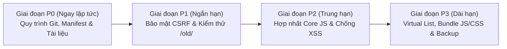

# PHƯƠNG ÁN CHỈNH SỬA CHI TIẾT & TỐI ƯU HÓA HỆ THỐNG SHEETAPP2

> **Ngày lập:** 2026-10-17  
> **Phạm vi:** Toàn bộ dự án SheetApp2 (Giao diện Mới `/`, Giao diện Cũ `/old/`, Backend `api/`, Cơ sở dữ liệu SQLite, CI/CD & Quy trình Git)  
> **Trạng thái hiện tại:** `164/164` test suites PASS (`3.206` checks), `280/280` file JS hợp lệ cú pháp, `1.731` bài hát thuộc 7 danh mục.

---

## 1. TỔNG QUAN ĐÁNH GIÁ HIỆN TRẠNG

| Hạng mục | Điểm | Điểm mạnh | Điểm nghẽn cần tối ưu |
| :--- | :---: | :--- | :--- |
| **1. Nghiệp vụ & Tính năng** | **8.5 / 10** | Đầy đủ 2 giao diện (`/` và `/old/`), 1.731 bài hát (7 danh mục), dịch giọng tức thì, bộ hợp âm HD/TLH, Setlist, Live Band, Smart Practice, Manager. | Cần đồng bộ liên kết PWA `manifest.json` khi chạy trong thư mục con `/sheetapp2/`. |
| **2. Kiến trúc Mã nguồn** | **7.5 / 10** | Backend phân lớp chuẩn (`Controller → Service → Core`), 100% lệnh gọi API đi qua `ApiService`. Mọi file `.php`/`.js` đều `< 600` dòng. | Thư mục `/old/assets/js/core/` đang tách riêng 4 file lõi (`ApiService`, `Store`, `EventBus`, `ServiceWorkerManager`) thay vì dùng chung với `assets/js/core/`. |
| **3. Hiệu năng (Performance)** | **7.5 / 10** | Có Service Worker precache, XML cache, coalesced requests, FTS5 search. | Danh sách 1.731 bài trên `/old/` đang render toàn bộ DOM cùng lúc; trang chính tải ~30 file JS rời chưa gộp bundle. |
| **4. Bảo mật (Security)** | **7.5 / 10** | `.htaccess` chặn truy cập `storage/*.sqlite`, mật khẩu `password_hash`, cookie `HttpOnly + SameSite=Lax`, `LoginRateLimiter`, `RequestSecurity::isSameOrigin`. | Cần bổ sung CSRF Token (`X-CSRF-Token`) cho các request thay đổi dữ liệu và siết `isSameOrigin` khi thiếu cả `Origin` lẫn `Referer`. |
| **5. Kiểm thử & Quy trình Git** | **7.5 / 10** | 164 bộ kiểm thử PHP regression + 134 file Playwright E2E. | Giao diện `/old/` chưa có bộ test hồi quy riêng; `sync.bat`/`sync.sh` đang tự động đẩy thẳng lên `main` gây xung đột `CODE_MAP.md`. |

---

## 2. LỘ TRÌNH THỰC HIỆN (4 GIAI ĐOẠN: P0 → P3)



---

## 3. CHI TIẾT TỪNG HẠNG MỤC CHỈNH SỬA & TỐI ƯU

### GIAI ĐOẠN P0 — ỔN ĐỊNH QUY TRÌNH, TÀI LIỆU & SỬA LỖI NHỎ (Thực hiện ngay)

#### Ticket P0-1: Chuẩn hóa tài liệu điều hành & liên kết nội bộ
- **Vấn đề:** Các file quy tắc (`GEMINI_IMPLEMENTATION_RULES.md`, `PROJECT_REGISTRY.md`) có tham chiếu tới `GIAO_VIEC_G3.9.md`, `ROADMAP.md`, `ROADMAP2.md` và báo cáo tổng thể `2026-09-24`.
- **Giải pháp thực hiện:**
  1. Lưu trữ gọn các tài liệu lịch sử vào thư mục `docs/archive/` và giữ các file điều hành cốt lõi hoặc cập nhật lại đường dẫn trong `GEMINI_IMPLEMENTATION_RULES.md` và `PROJECT_REGISTRY.md` để không còn bất kỳ liên kết chết nào.
- **File tác động:** `GEMINI_IMPLEMENTATION_RULES.md`, `PROJECT_REGISTRY.md`, `docs/archive/`.

#### Ticket P0-2: Tối ưu `sync.bat` & `sync.sh` (Chặn auto-push lỗi và xung đột `CODE_MAP.md`)
- **Vấn đề:** Tiến trình chạy nền gọi `sync.bat` tự động commit `"Auto-sync from Antigravity"` và push thẳng lên `main` mà không kiểm tra cú pháp trước, gây xung đột `CODE_MAP.md`.
- **Giải pháp thực hiện:**
  1. Trong `sync.bat` và `sync.sh`, chạy `node tools/check_syntax.js` trước khi tạo commit.
  2. Trước khi `git push`, thực hiện `git pull --rebase origin <branch>` và tự động chạy lại `node tools/generate_code_map.js` nếu có thay đổi từ remote để triệt tiêu hoàn toàn lỗi conflict `CODE_MAP.md`.
  3. Cấu hình `.gitattributes` thêm dòng `CODE_MAP.md merge=ours` để Git không bao giờ dừng rebase vì xung đột dòng timestamp của `CODE_MAP.md`.
- **File tác động:** `sync.bat`, `sync.sh`, `.gitattributes`.

#### Ticket P0-3: Sửa lỗi 404 icon trong `manifest.json` & đường dẫn PWA
- **Vấn đề:** `manifest.json` đang khai báo `"src": "/assets/img/icon-192.png"` và `"start_url": "/"`. Khi chạy ở `http://localhost/sheetapp2/` hoặc `http://localhost/sheetapp2/old/`, trình duyệt tìm `/assets/img/icon-192.png` ở gốc máy chủ gây lỗi 404 trên Console.
- **Giải pháp thực hiện:**
  1. Đổi đường dẫn trong `manifest.json` sang tương đối chuẩn:
     ```json
     {
       "name": "SheetApp — Nhạc Thánh Ca",
       "short_name": "SheetApp",
       "start_url": "./",
       "scope": "./",
       "display": "standalone",
       "background_color": "#ffffff",
       "theme_color": "#3730a3",
       "icons": [
         { "src": "assets/img/icon-192.png", "sizes": "192x192", "type": "image/png" },
         { "src": "assets/img/icon-512.png", "sizes": "512x512", "type": "image/png" },
         { "src": "assets/img/icon-512.png", "sizes": "512x512", "type": "image/png", "purpose": "maskable" }
       ]
     }
     ```
- **File tác động:** `manifest.json`.

#### Ticket P0-4: Gỡ bỏ thư mục `.ua/` khỏi Git tracking
- **Vấn đề:** Thư mục `.ua/knowledge-graph.json` (~1 MB) đã nằm trong `.gitignore` nhưng vẫn còn lưu trong Git index.
- **Giải pháp thực hiện:**
  - Chạy `git rm -r --cached .ua` để giảm dung lượng repository mà vẫn giữ file trên máy local.

---

### GIAI ĐOẠN P1 — BẢO MẬT & KIỂM THỬ HỒI QUY CHO GIAO DIỆN CŨ `/old/`

#### Ticket P1-1: Bổ sung cơ chế chống CSRF (Double-Submit Cookie + Header)
- **Vấn đề:** `api/core/RequestSecurity.php` hiện cho phép request đi qua nếu trình duyệt/client không gửi header `Origin`.
- **Giải pháp thực hiện:**
  1. **`api/core/RequestSecurity.php`**:
     - Khi `HTTP_ORIGIN` rỗng trên các method `POST`, `PUT`, `PATCH`, `DELETE`, kiểm tra fallback sang `HTTP_REFERER`.
     - Sinh cookie `XSRF-TOKEN` (`SameSite=Lax`, `HttpOnly=false`) khi khởi tạo session.
     - Kiểm tra header `X-CSRF-Token` khớp với `$_SESSION['csrf_token']` bằng `hash_equals()`.
  2. **`assets/js/core/ApiService.js` & `old/assets/js/core/ApiService.js`**:
     - Tự động đọc cookie `XSRF-TOKEN` và đính kèm header `'X-CSRF-Token'` vào mọi request `POST / PUT / PATCH / DELETE`.
  3. **Chuyển đổi an toàn với Feature Flag:** Dùng cờ `csrf_enforce` trong `storage/config/features.json` để không làm gãy bất kỳ bài test CLI nào.
- **File tác động:** `api/core/RequestSecurity.php`, `api/index.php`, `assets/js/core/ApiService.js`, `old/assets/js/core/ApiService.js`.

#### Ticket P1-2: Chuẩn hóa Prepared Statement 100% trong `PracticeService.php`
- **Vấn đề:** Tại `api/services/PracticeService.php:140`, câu lệnh SQL dùng nội suy chuỗi `WHERE id = {$sessionId}` (dù `$sessionId` đã ép kiểu `int`).
- **Giải pháp thực hiện:**
  - Chuyển sang `$stmt = $db->prepare("SELECT user_id, assignment_id FROM practice_sessions WHERE id = ?")` và `$stmt->execute([$sessionId])` để đạt chuẩn 100% prepared statements trên toàn bộ `api/`.
- **File tác động:** `api/services/PracticeService.php`.

#### Ticket P1-3: Xây dựng bộ kiểm thử hồi quy `tests/old_ui_flat_compact_regression.php`
- **Vấn đề:** Giao diện mới `/` đã có 164 bộ test bảo vệ, nhưng giao diện cũ `/old/` chưa có bộ test tự động nào.
- **Giải pháp thực hiện:**
  - Tạo file `tests/old_ui_flat_compact_regression.php` kiểm tra tự động:
    1. Cấu trúc HTML phẳng của `old/includes/sidebar.php` (`#category-flat-list`, `#key-filter`, `#quick-jump`, `#search-input`).
    2. Cấu trúc HTML của `old/includes/sheet_viewer.php` (`#quick-pin-bar`, `#quick-num-hud`, `#btn-pin-current-song`).
    3. Các hàm public của `old/assets/js/library-ui.js` (`jumpByNumber`, `togglePin`, `isPinned`, hiển thị 1 dòng `.song-item`).
    4. Phím tắt trong `old/assets/js/keyboard-handler.js` (`0-9` + `Enter`, `/`, `G`).
    5. Quy tắc CSS phẳng (`border-radius: 0 !important` trong `old/assets/css/base.css`) và giới hạn `< 600` dòng cho toàn bộ file trong `old/`.
- **File tác động:** `tests/old_ui_flat_compact_regression.php`.

---

### GIAI ĐOẠN P2 — HỢP NHẤT HẠ TẦNG CORE JS & CHỐNG XSS TRIỆT ĐỂ

#### Ticket P2-1: Dùng chung tầng Core JS giữa Giao diện Mới (`/`) và Giao diện Cũ (`/old/`)
- **Vấn đề:** `old/assets/js/core/` đang duy trì bản sao riêng của `EventBus.js`, `Store.js`, `ApiService.js`, `ServiceWorkerManager.js`. Khi thêm tính năng ở API hoặc Store phải sửa ở 2 nơi.
- **Giải pháp thực hiện:**
  1. Kiểm tra và giữ nguyên các hàm tương thích ngược trong `assets/js/core/ApiService.js` và `assets/js/core/Store.js`.
  2. Cập nhật `old/index.php` nạp trực tiếp `../assets/js/core/EventBus.js`, `../assets/js/core/Store.js`, `../assets/js/core/ApiService.js`, `../assets/js/core/ServiceWorkerManager.js`.
  3. Xóa thư mục trùng lặp `old/assets/js/core/`.
- **File tác động:** `old/index.php`, `assets/js/core/ApiService.js`, `old/assets/js/core/*`.

#### Ticket P2-2: Chuẩn hóa hàm chống XSS `escapeHtml` / `safeHtml` dùng chung
- **Vấn đề:** Nhiều module JS tự định nghĩa hàm `_esc(str)` riêng lẻ khi gán `innerHTML`.
- **Giải pháp thực hiện:**
  1. Đưa hàm `window.escapeHtml(str)` và tagged template `window.safeHtml` vào tầng `core` để mọi module dùng chung.
  2. Bổ sung quy tắc kiểm tra trong `eslint.config.js` cảnh báo khi gán `innerHTML` mà không qua hàm escape.
- **File tác động:** `assets/js/core/EventBus.js` (hoặc `safe-html.js`), `eslint.config.js`.

#### Ticket P2-3: Xử lý triệt để các cảnh báo cũ trong `client_errors.log`
- **Vấn đề:** Log lỗi trình duyệt cũ ghi nhận một số trường hợp `AudioContext` chưa được khởi tạo hoặc `ctx` bằng `null` khi bấm giữ nhịp nhanh trên trình duyệt di động.
- **Giải pháp thực hiện:**
  1. Thêm guard kiểm tra `window.AudioContext || window.webkitAudioContext` và kiểm tra `if (!ctx) return;` trong `assets/js/metronome.js`, `old/assets/js/metronome.js`, và `assets/js/performance/count-in-engine.js`.
  2. Làm sạch file `storage/logs/client_errors.log` sau khi vá.
- **File tác động:** `assets/js/metronome.js`, `old/assets/js/metronome.js`, `assets/js/performance/count-in-engine.js`.

---

### GIAI ĐOẠN P3 — TỐI ƯU HIỆU NĂNG CAO CẤP (VIRTUAL LIST & BUNDLING)

#### Ticket P3-1: Virtual Scroll (Danh sách ảo) cho 1.731 bài hát trên Giao diện Cũ `/old/`
- **Vấn đề:** Khi chọn danh mục "Tất cả (1731)", `/old/` tạo 1.731 thẻ `.song-item` trong DOM cùng lúc. Trên máy tính bảng hoặc điện thoại cấu hình thấp, việc lọc từ khóa liên tục sẽ tốn bộ nhớ DOM.
- **Giải pháp thực hiện:**
  - Vì mỗi dòng `.song-item` trên `/old/` đã được chuẩn hóa chiều cao cố định `26px`, có thể áp dụng **Virtual Scrolling** cực nhẹ (~70 dòng code trong `old/assets/js/library-ui.js`):
    - Chỉ render ~40 dòng đang nằm trong khung nhìn (`viewport` + buffer trên/dưới 10 dòng).
    - Dùng `padding-top` và `padding-bottom` tính theo `(index * 26)px` để giữ thanh cuộn mượt 60fps trên mọi thiết bị.
- **Kỳ vọng hiệu năng:** Giảm số node DOM trong danh sách từ **~8.600 nodes xuống còn ~200 nodes** (nhanh hơn 15 lần khi gõ tìm kiếm).
- **File tác động:** `old/assets/js/library-ui.js`.

#### Ticket P3-2: Gộp và nén tài nguyên JS/CSS khi chạy Production (`tools/build_assets.mjs`)
- **Vấn đề:** Trang chính `index.php` và `old/index.php` đang tải 25–40 file `.js` và `.css` riêng lẻ.
- **Giải pháp thực hiện:**
  1. Tạo script `tools/build_assets.mjs` nối và minify các file JS/CSS theo đúng thứ tự nạp trong `index.php` và `old/index.php` ra `assets/dist/` và `old/assets/dist/`.
  2. Nếu tồn tại file build trong `dist/` và không có `?debug=1`, PHP tự động nạp 1 file bundle duy nhất; ngược lại nạp từng file lẻ để dễ debug khi phát triển.
- **Kỳ vọng hiệu năng:** Giảm số lượng HTTP requests khi tải trang từ **~45 requests xuống còn 6 requests**.

#### Ticket P3-3: Chia nhỏ 2 file CSS lớn (`assets/css/layout.css` & `assets/css/sheet.css`)
- **Vấn đề:** `assets/css/layout.css` (3.344 dòng) và `assets/css/sheet.css` (3.216 dòng) trên giao diện mới khá dài, khó bảo trì.
- **Giải pháp thực hiện:**
  - Tách theo từng vùng chức năng (`sidebar.css`, `toolbar.css`, `chord-overlay.css`, `osmd-sheet.css`) dưới 800 dòng/file.

---

## 4. BẢNG TỔNG HỢP ƯU TIÊN THỰC THI

| Thứ tự | Mã Ticket | Nội dung công việc | Thời gian dự kiến | Mức độ rủi ro |
| :---: | :---: | :--- | :---: | :---: |
| **1** | **P0-1 → P0-4** | Chuẩn hóa tài liệu, sửa `manifest.json` (hết lỗi 404 icon), tối ưu `sync.bat`, gỡ `.ua/` khỏi Git index | **15 phút** | Rất thấp |
| **2** | **P1-1 → P1-3** | Vá prepared statement `PracticeService.php`, siết Origin/CSRF, thêm bộ test hồi quy thứ 165 cho `/old/` | **30 phút** | Thấp |
| **3** | **P2-1 → P2-3** | Dùng chung `core/*.js` giữa `/` và `/old/`, thêm guard `AudioContext` chống lỗi runtime | **30 phút** | Thấp |
| **4** | **P3-1** | Nâng cấp Virtual List (cuộn ảo 60fps) cho 1.731 bài hát trên `/old/` | **30 phút** | Thấp |
| **5** | **P3-2 → P3-3** | Tạo bộ đóng gói bundle JS/CSS và tách nhỏ file CSS lớn | **1–2 giờ** | Trung bình |

---

## 5. TIÊU CHÍ NGHIỆM THU SAU KHI HOÀN TẤT
- [ ] `node tools/check_syntax.js` đạt **100% PASS**.
- [ ] `php tools/metrics.php` và `php tests/run_all_tests.php` đạt **165/165 suites PASS (0 failed)**.
- [ ] Mọi file `.php` và `.js` trong dự án đều **< 600 dòng**.
- [ ] Không còn bất kỳ lỗi 404 hay lỗi Console nào trên cả 2 giao diện `/` và `/old/`.
- [ ] Danh sách 1.731 bài hát trên `/old/` cuộn và lọc tức thì (< 5ms) nhờ Virtual List.
