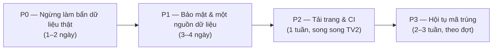

# PHƯƠNG ÁN TỐI ƯU HỆ THỐNG SHEETAPP2 (bản 2026-10-21)

> **Lưu trữ 2026-10-22:** đã gộp vào [`ROADMAP.md`](../../ROADMAP.md). Chỉ để tra cứu, không làm theo file này.

> **Ngày lập:** 2026-10-21 · **Mốc mã nguồn:** `main` @ `406aef6` (đã đồng bộ với `origin/main`)
> **Người đọc:** chủ dự án (duyệt, trả lời mục 6) và **một** người/AI thực thi.
> **Luật thực thi:** `ROADMAPS.md` mục 2. Ticket nào ghi DB thật, xoá dữ liệu, đổi quyền hoặc đổi Core Rule thì phải chờ chủ dự án duyệt.
> **Quan hệ với ROADMAP6:** ROADMAP6 vẫn là roadmap của trang Thư viện. File này chỉ thêm việc **toàn hệ thống** mà ROADMAP6 không có. Trùng chỗ nào thì ghi "→ TVx-y" và làm theo ROADMAP6, không làm hai lần.
> **Thay cho:** `docs/history/PHUONG_AN_TOI_UU_HE_THONG_2026-10-17.md` (P0–P3, đã thực hiện ở commit `e3dc9a3`).
> **Phương pháp:** đọc mã, đo bằng `wc`/`du`/`grep`/`diff`, đọc DB ở chế độ `mode=ro`. Chưa chạy lại toàn bộ test suite trong đợt rà soát này. Mục nào đánh ✅ là đã kiểm chứng trực tiếp trong code.

---

> **Rà soát lại 2026-10-21:** xem [báo cáo thực thi và phần còn mở](docs/OPT_REVIEW_2026-10-21.md). Q4 đã duyệt và triển khai; Q1 đã duyệt, xoá đúng 63 backup cũ. Lỗi alias xoá bộ chuẩn đã được duyệt và sửa. Lượt tổng sau sửa alias: 184/184 suite PASS, 3.740 checks, 0 SKIP. Chưa nghiệm thu toàn bộ phương án; OPT-12 mới khớp 57/60 file. Bảng quyết định/chữ ký giữ nguyên.

## 0. TÓM TẮT

Về tính năng, hệ thống đã khá đầy đủ: hai giao diện Modern `/` và Classic `/old/`, 1.731 bài, 7 sub-app, 176 bộ test PHP, 172 spec E2E. Vấn đề còn lại nằm ở 5 nhóm, xếp theo mức nghiêm trọng:

1. **Test và tool đang ghi vào dữ liệu thật.** Có 66 file backup (478 MB) do một bộ test tự tạo. 97% dòng trong `audit.log` sinh ra từ CLI. Cache bài hát không bao giờ bị xoá đúng chỗ.
2. **Bảo mật:** CSRF vẫn tắt. API đọc bộ hợp âm không kiểm tra quyền riêng tư. Có endpoint ghi log không qua router.
3. **Hai nguồn dữ liệu cho bộ hợp âm:** DB có 1.737 dòng, đĩa có 60 file JSON, và hệ thống lặng lẽ đọc file đĩa khi DB lỗi.
4. **Tải trang nặng:** Modern nạp 84 file JS, 1,99 MB, thấy bản nhạc sau 11,2 s trên 4G. Khoảng 1 MB JS còn truyền không nén.
5. **Mã trùng và mã chết:** Classic có 22 file JS fork đã lệch hẳn bản chính. Hai hệ đồng bộ live chạy song song, hai bộ đọc SATB. Có các wrapper chỉ để lách ngân sách 600 dòng, và 10 feature flag phía JS không có ai đọc.

**Việc đã làm ngay trong đợt này** (chỉ đụng tài liệu và file rác, không đụng mã chạy hay dữ liệu thật):
- Chuyển 9 roadmap/phiếu cũ ở thư mục gốc vào `docs/history/` bằng `git mv`, giữ nguyên lịch sử.
- Tạo `ROADMAPS.md` làm chỉ mục duy nhất. File này gồm luật thực thi chép từ ROADMAP3 Phần 0 và bảng lịch sử.
- Sửa các con trỏ đã cũ trong `AGENTS.md`, `GEMINI.md` và `ROADMAP6.md`.
- Xoá `.superpowers/scratch_find_bpm_tables.php` (script nháp dùng một lần) và các thư mục sinh lại được: `test-results/` (5,3 MB), `tests/__pycache__`, `tools/__pycache__`.

---

## 1. HIỆN TRẠNG ĐO ĐƯỢC

| Hạng mục | Số đo | Nguồn |
|---|---|---|
| Backend | 20 controller (2.568 dòng), 35 service (8.933), 12 core (862), 16 migration | `wc -l api/**` |
| Frontend Modern | 119 file JS của dự án, 35.010 dòng; 8 file CSS 362 KB, 673 `!important` | `assets/` |
| Frontend Classic | 22 file JS fork (7.226 dòng) cộng 23 file lấy từ Modern; 4 file CSS 104 KB, 207 `!important`; 86% selector trùng Modern | `old/` |
| Tải trang 4G, cache lạnh | Modern 84 JS / 103 request / 1.993.443 byte / SVG 11.225 ms · Classic 45 / 59 / 1.299.141 / 7.759 ms. Ngân sách: ≤40 / ≤60 / ≤1,5 MB / ≤2.500 ms | `docs/ROADMAP6_TV2_AUDIO_COMPRESSION.md` |
| Test | 176 bộ PHP; theo heuristic thì khoảng 65 bộ (~37%) chỉ grep file nguồn · 172 spec E2E, trong đó 151 thuộc Thư viện; live-band 3, learn 1, editor 2 | `tests/`, `e2e/` |
| CI | 1 job: chạy `run_all_tests.php` trên Apache. Không có ESLint, không có E2E, không có `--strict` | `.github/workflows/ci.yml` |
| Storage | `storage/backups` 74 file / 493 MB · `storage/logs` 2,4 MB, không xoay vòng | `du` |
| Tài liệu nạp mỗi phiên AI | `PROJECT_REGISTRY.md` 1.521 dòng / 185 KB, nạp qua `CLAUDE.md` vào mọi phiên | `wc -c` |

---

## 2. LỘ TRÌNH

Ước lượng tính cho một người thực thi và chưa gồm thời gian chờ chủ dự án duyệt.

---

## 3. CHI TIẾT TICKET

### 🔴 P0 — Ngừng làm bẩn dữ liệu thật & vệ sinh kho

#### OPT-01 · Test r34 không được tạo backup vào storage thật · S ✅
- **Vấn đề:**
  - `tests/library_r34_labels_migration_regression.php:150` gọi `tools/manage_song_labels.php --backup` trên DB production.
  - Tool này dùng `copy()` ở `:125` để tạo file `storage/backups/app_before_r34_*.sqlite`.
  - Mỗi lần chạy test sinh thêm khoảng 7–10 MB. Hiện đã có 66 file / 478 MB. Đây là vi phạm luật 6.
- **Sửa:**
  - Thêm cờ `--db=<path>` và `--backup-dir=<path>` cho tool.
  - Test dùng bản sao trong thư mục tạm và dọn sau khi chạy.
  - Đổi `copy()` sang `VACUUM INTO`, đúng mẫu đã có ở `tools/update_library.php:33`, để backup nhất quán khi DB đang ở chế độ WAL.
- **Nghiệm thu:** chạy test 3 lần liên tiếp, số file trong `storage/backups/` không đổi.
- **File:** `tools/manage_song_labels.php`, `tests/library_r34_labels_migration_regression.php`.

#### OPT-02 · Chính sách giữ backup & dọn 478 MB · S · **cần chủ dự án duyệt (Q1)**
- **Sửa:**
  - Viết `tools/prune_backups.php`, mặc định chạy dry-run.
  - Mỗi tiền tố giữ N bản mới nhất, cộng mọi bản được tạo trước một migration.
  - Chỉ xoá khi có `--apply`.
- **Lưu ý:** bước xoá thật chỉ chạy sau khi chủ dự án duyệt danh sách dry-run.

#### OPT-03 · Test không ghi vào log thật · S
- **Vấn đề:**
  - `storage/logs/audit.log` có 8.480 dòng, trong đó 8.234 dòng mang IP "CLI".
  - `storage/logs/mail/` có 462 file mail giả.
- **Sửa:**
  - Thêm `AuditLogger::setLogPath()`, `NotificationDeliveryService` nhận thư mục mail cấu hình được.
  - `tests/run_all_tests.php` đặt cả hai vào thư mục tạm.
  - Thêm xoay vòng log theo kích thước cho `audit.log` và `client_errors.log`.
- **Nghiệm thu:** chạy toàn bộ suite xong, `audit.log` không thêm dòng nào.

#### OPT-04 · Cache bài hát được xoá đúng chỗ · S ✅
- **Vấn đề:** `invalidateLabelsCache()` ở `tools/manage_song_labels.php:134-145` xoá file trong `storage/cache/`, nhưng thư mục này không tồn tại. Cache thật nằm ở `storage/data/songs_cache.json`. Hậu quả: gắn nhãn xong, khách vẫn thấy dữ liệu cũ tới 1 giờ.
- **Sửa:**
  - Mọi tool ghi dữ liệu bài hát đều gọi một hàm xoá cache chung (lấy đường dẫn từ `SongService::cachePath()`).
  - Lưu sẵn ETag cạnh file cache, để mỗi request không phải hash lại 636 KB.

#### OPT-05 · Bỏ tự push trong `sync.sh` / `sync.bat` · S ✅
- **Vấn đề:** cả hai script chạy `git add -A`, `commit --amend` rồi `git push origin main` (`sync.sh:18-23`). `npm run sync` vẫn trỏ vào đây. Việc này trái với `AI_AGENT.md` mục 1.7.
- **Sửa:**
  - Chỉ giữ ba bước: kiểm cú pháp, sinh `CODE_MAP.md`, sinh SW manifest.
  - Bỏ add/commit/push và đổi tên thành `prepare`.
  - Xoá script `test:ui` vì nó trỏ tới file không tồn tại `tools/test_editor_ui.js`.
  - Gỡ `puppeteer-core` khỏi `package.json` vì không chỗ nào dùng.

#### OPT-06 · `.gitignore` & file không nên theo dõi · S
- **Ngừng theo dõi** (dùng `git rm --cached`, file trên đĩa giữ nguyên):
  - `storage/data/songs_cache.json`: file sinh lúc chạy, 11 commit, 648 KB.
  - `storage/users/**/*.xml.bak`.
  - `storage/config/features.json`: cấu hình riêng từng server; thay bằng `features.example.json`.
- **Bổ sung `.gitignore`:**
  - Thêm `*.bak` và `.superpowers/scratch_*`.
  - Bỏ dòng lặp `storage/omr_workspace/` và dòng thừa `storage/tenants/`, vì multi-tenant đã gỡ ở `595b507`.
- **Pattern `archive/`:** hiện pattern này ignore cả `docs/archive/`, nên ROADMAP4 và ROADMAP6/7 bản gốc chỉ còn trên máy local. Theo **Q2**, chọn một trong hai:
  - đưa các file đó vào `docs/history/`;
  - hoặc chấp nhận để local-only.

#### OPT-07 · Tách nhật ký khỏi `PROJECT_REGISTRY.md` · S · **cần chủ dự án duyệt (Q3)**
- **Vấn đề:**
  - File 185 KB, nạp vào mọi phiên AI qua `CLAUDE.md`. Khoảng 80% là nhật ký thay đổi từ 2026-05 tới nay.
  - Có mục mô tả file không còn tồn tại, ví dụ `TenantContext` và `TenantProvisioningService` ở `:247` và `:1231-1241`.
  - Danh sách `ROADMAP7.md` ở sơ đồ thư mục cũng đã sai.
- **Sửa:**
  - Chuyển nhật ký theo ngày sang `docs/history/CHANGELOG_2026.md`.
  - Registry chỉ giữ cấu trúc, API contract, schema, gotchas, ADR và 5 mục nhật ký mới nhất.
  - Sửa các mục đã lỗi thời. Đánh dấu ADR-005 là "Đã gỡ".
- **Lợi ích:** mỗi phiên AI nạp ít đi khoảng 150 KB ngữ cảnh.

#### OPT-08 · Dọn mã chết đã xác định · S
- `assets/js/key-service.js`: 184 dòng, không trang nào nạp. Bản đang dùng là `core/KeyService.js`. Cần cập nhật test đang tham chiếu tới file này.
- `members/members.js` (476 dòng) và `members/members.css` (818 dòng): `members/index.php` chỉ redirect sang `/manager/`.
- Trong `assets/js/core/FeatureFlags.js` có 10 cờ phía JS không chỗ nào gọi `FeatureFlags.get()`. Mỗi cờ phải được nối vào code thật hoặc xoá.
- Theo luật 1.3 của `AI_AGENT.md`, liệt kê danh sách cho chủ dự án duyệt trước khi xoá.

---

### 🟠 P1 — Bảo mật & một nguồn dữ liệu

#### OPT-09 · Quyền đọc bộ hợp âm · S · **lỗ hổng mới, cần chủ dự án xác nhận (Q4)** ✅
- **Vấn đề:**
  - `ChordSetController.php:19-40` cho khách gọi `list`, `load`, `details`.
  - `ChordSetService::loadSet` ở `:91-110` không lọc `is_public` hay chủ sở hữu.
  - `listSets` gộp tên file trên đĩa mà không xét quyền riêng tư.
  - `deleteSet` vẫn xoá file trên đĩa khi DB không xoá được dòng nào.
- **Sửa:**
  - `load`/`details` chỉ trả bộ HD, bộ TLH, bộ công khai, hoặc bộ của chính người đang đăng nhập.
  - `list` bỏ phần gộp từ đĩa.
  - `deleteSet` chỉ xoá file khi `rowCount() > 0`.
- **Core Rule 1:** HD và TLH vẫn đọc được với mọi người.
- **Nghiệm thu:** test HTTP cho bốn tình huống: khách, chủ bộ, người khác, admin.

#### OPT-10 · Bật CSRF → TV4-4 · S
- `csrf_enforce` mặc định là `false` (`api/core/FeatureFlags.php:9`), và `features.json` không có key này.
- Ticket này thuộc ROADMAP6 TV4-4. File này chỉ đề xuất **lịch bật**:
  1. bật trên staging;
  2. chạy E2E toàn bộ thao tác ghi (lưu hợp âm, setlist, ghi chú, quản trị);
  3. bật trên production theo **Q5**.

#### OPT-11 · Siết các endpoint phụ · S
- **`api/log_error.php`:** đang đi vòng qua router, không auth, không giới hạn, ghi nối không hạn chế. Sửa:
  - đưa vào router (`route=client_log`);
  - kiểm tra Origin;
  - giới hạn kích thước body ≤ 8 KB;
  - rate-limit theo IP.
- **Đăng ký tài khoản:** thêm rate-limit, dùng lại `LoginRateLimiter`.
- **Export ChordPro:** `ChordProService.php:40-48` đang dùng `file_exists` thô. Đổi sang đọc qua `SongService::resolveManagedXmlPath`.
- **Lộ thông báo lỗi:** thay `Throwable->getMessage()` trả ra client bằng `Response::serverError` ở các chỗ sau:
  - `ChordSetController:127`
  - `AuthController:148`
  - `PracticeAssignmentController:73,93`

#### OPT-12 · SQLite là nguồn duy nhất của bộ hợp âm · M · **cần Q6**
- **Hiện trạng:** DB có 1.737 dòng, đĩa có 60 file JSON (được theo dõi trong git). Hệ thống đọc dự phòng từ đĩa khi DB lỗi, và lỗi DB bị nuốt mất.
- **Sửa:**
  - Bỏ nhánh đọc dự phòng và log lỗi DB.
  - Trước khi bỏ, chạy `tools/migrate_json_chord_sets_to_db.php --reconcile --dry-run` để chứng minh 60 file đều đã có trong DB.
  - File JSON trở thành bản export, không còn là nguồn đọc.
  - Gộp `ManagerService::saveUserChordSet:303` vào `ChordSetService`.
- **Nghiệm thu:** đối chiếu checksum 60/60 trước khi bỏ. Test không có file đĩa vẫn PASS.

#### OPT-13 · Đúng kiến trúc ở các điểm còn lệch · S
- **SQL còn nằm trong controller:** chuyển vào service.
  - `ReviewController.php:120-131`
  - `SetlistController.php:229`
- **`hasColumn`/`hasTable` bị chép y hệt** ở `SetlistService:24-38` và `SetlistUsageHelper:13-29`, mỗi lần gọi chạy `PRAGMA`, tổng 31 chỗ gọi. Schema đã có phiên bản migration nên có thể bỏ hẳn. Nếu chưa bỏ được thì gom vào `DB` kèm cache theo request.

---

### 🟡 P2 — Tải trang, offline & CI

#### OPT-14 · Nén mọi JS/CSS tĩnh · S → bổ sung TV2
- **Hiện trạng:**
  - Gzip dựng sẵn mới áp cho 4 file: OSMD và 3 CSS (`assets/.htaccess`).
  - Khoảng 1 MB JS của dự án vẫn truyền thô.
  - Production chạy OpenLiteSpeed, nên `Header set` trong `.htaccess` không có hiệu lực (theo registry 2026-10-20).
- **Sửa:**
  - Mở rộng `tools/generate_asset_gzip.php` cho toàn bộ `assets/js/**/*.js` và `assets/css/*.css`.
  - Thêm bước `--check` vào CI để chặn file `.gz` cũ.
  - Kiểm tra cách phục vụ `.gz` trên OpenLiteSpeed.
- **Mục tiêu:** Modern dưới 1,2 MB truyền trên 4G.

#### OPT-15 · Bỏ thẻ script trùng với preset của ScriptLoader → TV2-2
- **Số đo:** trong 34 đường dẫn mà `ScriptLoader` khai báo, 32 file đã có sẵn trong `index.php`. Hiện chỉ Tone.js và OsmdAudioPlayer thực sự tải theo nhu cầu.
- `prefetchIdle` (`ScriptLoader.js:146`) prefetch hai file đã nạp sẵn, nên không có tác dụng.
- Thực hiện theo TV2-2. Mục tiêu ≤ 40 JS lúc khởi động.

#### OPT-16 · Ghép file nhóm core · M · **sau OPT-15, theo Q7**
- Nếu sau OPT-15 vẫn vượt 60 request, viết bước nối file đơn giản (không minify) cho nhóm `core/*` của cả hai giao diện.
- Giữ thứ tự nạp đúng như Load Order trong `PROJECT_REGISTRY.md` mục 8.
- Không đưa bundler vào dự án.

#### OPT-17 · Service Worker sinh từ công cụ → TV2-5
- **Vấn đề:**
  - `SW_MANIFEST_HASH` đang gõ cứng (`sw.js:14`). Danh sách precache lệch khỏi `tools/generate_sw_manifest.php`: chỉ có 39 JS so với 84 file nạp sẵn, và thiếu `library-polish.css`.
  - Vendor dùng cache-first với phiên bản cố định `v5`, nên nâng OSMD mà quên đổi số thì người dùng vẫn nhận bản cũ.
- **Sửa:**
  - CI chạy generator ở chế độ `--check`.
  - Cache vendor theo hash nội dung file.

#### OPT-18 · CI đầy đủ hơn · M
- Thêm ESLint (`--js`).
- Thêm một job Playwright Chromium chạy khoảng 20 spec chính: Thư viện mở bài, đổi tông, lưu hợp âm, setlist, offline.
- Cache npm và apt. Chạy `--strict` cho các suite HTTP vì CI đã có Apache.
- Theo dõi riêng 19 suite đang FAIL do môi trường CLI/HTTP trên server. Không được che chúng bằng SKIP.

#### OPT-19 · Báo cáo tỉ lệ test hành vi trung thực · S
- `run_all_tests.php` đang mặc định coi mọi suite là "behavioral". Chỉ có 29 suite được khai báo là static, trong khi heuristic cho thấy khoảng 65 suite chỉ grep.
- **Sửa:**
  - Mỗi suite khai báo loại của nó.
  - Runner tự đếm loại và in ra.
  - Suite chưa khai báo thì tính là static.
- Không viết lại test ở ticket này. Việc chuyển dần sang test hành vi làm theo đợt ở P3.

#### OPT-20 · Hiệu năng backend nhỏ · S
- Thêm index `songs(httlvnId)`, phục vụ `SongService::getById:177`.
- Gói offline gọi `loadSet` theo từng bài, mỗi lần một query cộng glob (`SetlistOfflineHelper.php:71-73`). Gom thành một query `WHERE song_id IN (…)`.
- Giãn khoảng poll SSE từ 100 ms lên 250 ms (`LiveSyncService:452,511`). Hiện mỗi kết nối giữ một PHP worker 25 giây.
- Thêm job đối soát FTS: so số dòng `songs` với `songs_fts`. FTS hiện đồng bộ tay qua 7 chỗ gọi.

---

### ⚪ P3 — Hội tụ mã trùng (theo đợt, mỗi đợt có E2E chặn hồi quy)

#### OPT-21 · Classic dùng chung module với Modern → TV6
- Chủ dự án đã quyết định ngày 2026-10-18: Classic là chế độ chính thức, **không đóng băng**.
- 22 file JS fork của Classic lệch bản Modern từ 538 tới 1.012 dòng diff mỗi file. Classic lại chạy lẫn 23 module Modern, nên dễ hỏng khi Modern thay đổi.
- **Hướng làm:**
  - Thêm cấu hình `__APP_PROFILE__ = 'classic' | 'modern'`.
  - Mỗi đợt chuyển 2–3 module, bắt đầu từ file ít khác biệt nhất.
  - Bỏ các nhánh `/old/` trong `core/Store.js`, `ServiceWorkerManager.js:12`, `OfflineVault.js` và `sw.js:141` (→ TV6-3).
- **Nghiệm thu mỗi đợt:** E2E hai giao diện PASS, so ảnh chụp không đổi.

#### OPT-22 · Một hệ đồng bộ live · M–L
- **Hiện trạng:** trang chính dùng `live-sync.js` → `performance/live-session.js` + `performance-engine.js`, còn live-band dùng `performance/live-transport.js` (SSE).
- **Sửa:**
  - Chọn một transport (SSE có fallback polling), hai bên dùng chung.
  - Bổ sung E2E cho live-band: hiện mới có 3 spec.

#### OPT-23 · Một bộ đọc SATB · M
- `editor/js/editor-parser.js` và `assets/js/learn/harmony/learn-satb.js` đều tự viết `parseNoteData` và gom hợp âm theo nhịp.
- Tách thành `assets/js/core/SatbParser.js` và viết test đơn vị bằng MusicXML thật.

#### OPT-24 · Bỏ wrapper chỉ để lách ngân sách 600 dòng · M · **theo Q8**
- `ManagerService:70-117` chỉ chuyển tiếp sang hai helper. `LiveSyncService` bọc thêm một lớp quanh `LiveSyncStorageHelper`. Comment ở `ReviewActionHelper.php:6` và `PracticeAssignmentCreationHelper.php:6` nói rõ chúng được tách chỉ để lách ngân sách.
- **Đề xuất:** đổi tiêu chí từ "≤ 600 dòng/file" sang "≤ 30 dòng/hàm và một trách nhiệm/file".
- Tách theo nghiệp vụ thật: ví dụ `ManagerService` thành `RepertoireService` và `MemberService`. Controller gọi thẳng service, không qua facade.

#### OPT-25 · CSS → TV3-7
- Gộp `library-polish.css` vào các file gốc. File này chiếm 505 trên 673 `!important` của Modern.
- Dùng token chung cho breakpoint: hiện có 20 giá trị khác nhau, từ 350 tới 1440 px.
- Mục tiêu ≤ 120 `!important`. Làm theo TV3-7.

#### OPT-26 · Lưu trữ tool & tài liệu đã xong · S
- **Tool chạy một lần, đã xong việc:** chuyển vào `tools/archive/`.
  - `migrate_json_chord_sets_to_db`, `extract_keys`, `create_hd_sets`, `seed_song_sections`
  - `import_thanh_ca_catalog`, `fetch_sheet.py`, `batch_fetch_all.py`, `index_lyrics`, `omr_sync`
- **Fixture E2E:** chuyển `create_test_*` và `setup_e2e_*` vào `e2e/helpers/`.
- **Báo cáo đã xong:** chuyển vào `docs/history/`, rồi cập nhật đường dẫn trong registry.
  - `ROADMAP5_R5_ACCEPTANCE_REPORT`, `ROADMAP6_IMPLEMENTATION_REPORT` (R6 cũ), `ROADMAP7_IMPLEMENTATION_REPORT`
  - `SYSTEM_DEEP_AUDIT_REPORT`, `THU_VIEN_FULL_AUDIT_2026-10-02`, `MOBILE_CHORD_EDIT_UX_REVIEW_2026-10-02`, `SHEETAPP2_ARCHITECTURE_REVIEW_AND_ROADMAP`
- Giữ nguyên `docs/SPELLING_AUDIT_REPORT.md` vì test `library_l65` kiểm tra file này tồn tại.
- **Chỉ dẫn agent:** gộp nội dung chung của `CLAUDE.md`, `AGENTS.md` và `GEMINI.md` về một nguồn. Mỗi file chỉ còn phần riêng của công cụ đó.
- **Tham chiếu chết:** `CLAUDE.md` yêu cầu đọc `.superpowers/skills/using-superpowers/SKILL.md`, nhưng file này không có trong kho. Cần sửa tham chiếu.

---

## 4. THỨ TỰ THỰC HIỆN ĐỀ XUẤT

| Đợt | Ticket | Điều kiện |
|---|---|---|
| 1 | OPT-01, 03, 04, 05, 06 (trừ Q2) | Không cần quyết định |
| 2 | OPT-02, 07, 08 | Q1, Q3 |
| 3 | OPT-09, 11, 13 | Q4 |
| 4 | OPT-10, 12 | Q5, Q6; backup trước |
| 5 | OPT-14, 15, 17, 18, 19, 20 | Song song TV2 |
| 6 | OPT-16 | Chỉ khi sau đợt 5 vẫn vượt ngân sách (Q7) |
| 7+ | OPT-21 → 26 | Theo đợt nhỏ, E2E hai giao diện mỗi đợt |

---

## 5. THANG NGHIỆM THU

| Chỉ số | Hiện tại | Mục tiêu |
|---|---|---|
| File backup do test tạo / lần chạy suite | ~1 file, 7–10 MB | 0 |
| Dòng `audit.log` mang IP "CLI" sau một lần chạy suite | tăng | 0 |
| Endpoint đọc bộ hợp âm riêng tư mà khách gọi được | có | 0 |
| `csrf_enforce` trên production | tắt | bật |
| Nguồn đọc bộ hợp âm | DB + đĩa | chỉ DB |
| Modern, 4G cache lạnh | 84 JS / 103 req / 1,99 MB / SVG 11,2 s | ≤ 40 / ≤ 60 / ≤ 1,5 MB / ≤ 2,5 s (theo ROADMAP6 Q6) |
| CI | PHP | PHP + ESLint + E2E smoke |
| Tỉ lệ suite hành vi, runner tự đếm | báo cáo theo mặc định | số đo thật, tăng dần qua mỗi đợt |
| `PROJECT_REGISTRY.md` | 185 KB | ≤ 40 KB |
| JS fork của Classic | 22 file | giảm theo từng đợt OPT-21 |

---

## 6. QUYẾT ĐỊNH CẦN CHỦ DỰ ÁN

| # | Câu hỏi | Đề xuất |
|---|---|---|
| Q1 | Bao nhiêu backup được giữ lại trong 74 file / 493 MB? | Giữ 3 bản `app_before_r34_*` mới nhất, cộng mọi bản trước migration. Duyệt danh sách dry-run trước khi xoá |
| Q2 | Có đưa ROADMAP4, ROADMAP6 cũ và ROADMAP7 từ `docs/archive/` (chỉ có local) lên GitHub không? | Có: đưa vào `docs/history/` |
| Q3 | Có tách nhật ký khỏi `PROJECT_REGISTRY.md` không? | Có: giảm ~150 KB ngữ cảnh mỗi phiên AI |
| Q4 | Bộ hợp âm cá nhân không công khai có cần ẩn với khách và với người dùng khác không? | Có: chỉ HD, TLH, bộ công khai và bộ của chính mình |
| Q5 | Bật CSRF trên production lúc nào? | Sau khi staging chạy E2E ghi PASS |
| Q6 | Có bỏ đọc dự phòng bộ hợp âm từ file đĩa không? | Có, sau khi đối soát 60/60 |
| Q7 | Có chấp nhận một bước nối file JS (không bundler) không? | Chỉ khi OPT-15 chưa đạt ngân sách |
| Q8 | Có đổi tiêu chí "≤ 600 dòng/file" sang "≤ 30 dòng/hàm, một trách nhiệm/file" không? | Có |

---

## 7. NGOÀI PHẠM VI

- Không đưa framework, bundler hay TypeScript vào dự án.
- Không đóng băng hay gỡ Classic `/old/`.
- Không đụng tới 4 Core Rule (HD mặc định, tông gốc = 0, khoá TLH/HD, đồng bộ setlist).
- Không deploy, không push. Commit chuẩn bị trên nhánh để chủ dự án duyệt.

## PHỤ LỤC — Nguồn bằng chứng

- Số đo tải trang: `docs/ROADMAP6_TV2_AUDIO_COMPRESSION.md`, `docs/ROADMAP6_TV2_PROGRESS.md`.
- Trạng thái TV: bảng ở đầu `ROADMAP6.md`, `docs/ROADMAP6_LIBRARY_ACCEPTANCE_REPORT.md`.
- Đã kiểm chứng trực tiếp:
  - `tests/library_r34_labels_migration_regression.php:150`
  - `tools/manage_song_labels.php:125,134-145`
  - `api/core/FeatureFlags.php:9`
  - `api/controllers/ChordSetController.php:15-42`
  - `api/services/ChordSetService.php:91-112`
  - `sync.sh:18-23`, `package.json:6,8`
